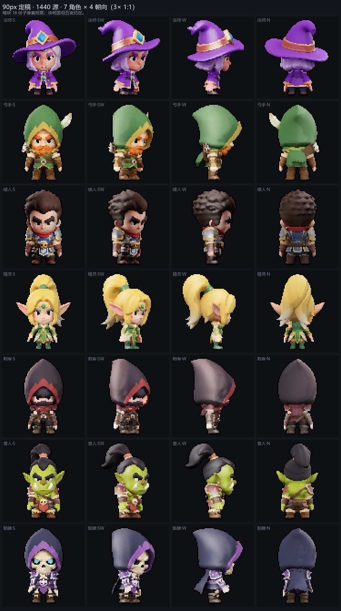
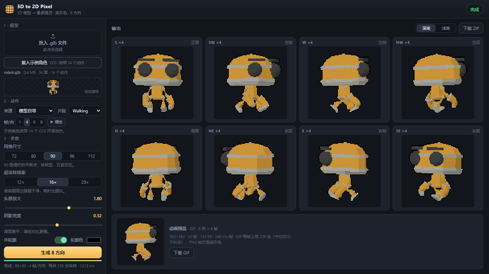

# 3D to 2D Pixel <a href="https://jim-jiang-github.github.io/3Dto2D_Pixel/"></a>

**Turn 3D models (.glb) into true-color pixel-art sprites with 8 directions — in your browser or offline with Blender.**

拖一个 `.glb` 进去，得到 8 方向像素精灵 + 游戏图集 + 旋转 GIF。可以一键载入自带 14 个开源动作的示例角色，直接出**骨骼动画**精灵表。真彩色、无减色、无抖动，纯前端零上传，模型不出本机。



## 两种用法

| | Web UI（推荐） | Blender 离线管线 |
| --- | --- | --- |
| 入口 | 双击 `start-webui.bat`，或 `python -m http.server 8765` 后打开 `/webui/` | `python tools/build_cast_px.py --glb-dir assets/characters` |
| 依赖 | 只要浏览器（three.js 已内置于 `webui/vendor/`） | Blender 4.x + `pip install -r requirements-dev.txt` |
| 适合 | 单个模型、即时预览调参 | 批量出整套精灵、可脚本化 |

Web UI 界面（左侧模型与调参，右侧 8 方向输出与 GIF 预览，单屏无滚动）：



## 它在做什么

核心配方（浏览器与 Blender 两端完全一致）：

1. **高分无抗锯齿渲染**。正交相机按 8 个朝向渲染到 `目标尺寸 × 超采样倍率` 的画布（默认 90×16=1440）。关抗锯齿是关键：每个子像素都是模型真实的着色结果，不会和透明背景混出半透明边。
2. **分块颜色投票**。每个目标块里所有不透明子像素按颜色分 8 桶投票，块保留票数最多那一组的平均色。块色永远来自模型上真实存在的颜色——**不做全局减色，不做抖动**。
3. **1px 墨线**。只在剪影外侧的透明像素上画，不压本体。

为什么必须投票而不是直接缩小：一块只采一条光线时，比块还细的特征（眼睛高光、帽绳）要么消失、要么炸成孤立杂点，肉眼读作"脏"。渲染大再投票，杂点输掉选举而不是被平均成灰。

> ⚠️ 不要走"调色板量化 / 色阶合并"的路：会把皮肤和衣料弄出脏斑，观感是"16 色图"。像素风格 ≠ 减色，**网格化（几何）与调色板（色彩）是两件事**。

## 骨骼动画

三个入口，面板里的「动作 · 来源」切换：

| 来源 | 说明 |
| --- | --- |
| 静态姿势 | 只出单帧（原有行为） |
| 内置动作 | 待机 / 行走 / 奔跑，本仓库用代码直接生成，无第三方素材 |
| 模型自带 | 读取 GLB 里的动画片段，原样播放（点「载入示例角色」可试） |

内置动作是**按角色自身的前 / 侧 / 上三个轴**写的程序化姿势：每个骨骼的旋转先在世界空间算好，再共轭到该骨骼的局部坐标，所以同一套动作能套在不同 roll 约定的骨架上，不会出现"腿往外劈叉"。参数在 `webui/anims.js` 的 `WALK` / `RUN` 里，改幅度直接生效。

「帧/向」选 1 / 4 / 6 / 8：每个朝向均匀采样该片段 N 帧，输出 8×N 的精灵表。多帧时 GIF 预览按完整循环播放，ZIP 里帧文件命名为 `S_0.png`、`S_1.png`…

**示例角色**：`webui/assets/demo/robot.glb`，来自 three.js 官方示例的 [RobotExpressive](https://github.com/mrdoob/three.js/tree/dev/examples/models/gltf/RobotExpressive)，作者 Tomás Laulhé，Don McCurdy 修改，**CC0 公共领域**，可自由分发。它自带 14 个动作：Idle / Walking / Running / Jump / Dance / Wave / Punch / Sitting / Standing / Death / No / Yes / ThumbsUp / WalkJump。

> 关于 Mixamo：Adobe 的条款不允许二次分发动作文件，所以仓库不会打包它。跨骨架重定向（Mixamo → 本项目骨架）也试过，因为两套骨骼的 roll 约定差异太大，任何变体都会留下永久性倾斜，宁可没有这个功能也不放个坏的上线，相关代码已移除。

## 参数

| 参数 | 说明 |
| --- | --- |
| 网格尺寸 | 72 / 80 / 90 / 96 / 112。**90 是调好的平衡点**：块一眼可见，五官还在；72 时眼睛开始塌，112 丢块感。 |
| 超采样倍率 | 每块采多少子像素。16× 时每块 256 份采样，2 秒左右出 8 帧。 |
| 头部放大 | 缩放 `Head` 骨骼，Q 版大头。默认 1.8。 |
| 动作 / 帧每向 | 动作来源与每个朝向采样的帧数，见上方「骨骼动画」。 |
| 阴影亮度 | 三档硬光里最暗档的亮度（默认 0.52）。 |
| 外轮廓 | 剪影外侧 1px 墨线，颜色可换。 |

手臂会自动从 T-pose 下垂到 76°，否则取景会被张开的双臂撑宽，角色在画面里小三分之一。

## 输出

- 8 张 `S/SW/W/NW/N/NE/E/SE.png`（`cell_w = cell_h = 网格尺寸`）；多帧时是 `S_0.png … S_3.png`
- `sheet.png`：静态时 4×2 图集；带动画时 8 行 × N 列（每行一个朝向）
- `spin.gif`：8 方向循环旋转（4× 最近邻放大、150 ms/帧），多帧时按完整循环播放
- `sprite.json`：尺寸、朝向顺序、`frames_per_dir`、`anim`（来源 / 片段名 / 时长）等元数据
- 以上全部打包 ZIP 下载

## 仓库结构

```text
webui/               浏览器工具：渲染、投票降采样、图集与 GIF 导出（纯前端，离线可用）
  anims.js             程序化待机/行走/奔跑（角色空间 → 骨骼局部空间共轭）
  pixelate.js          投票降采样、墨线、单帧/多帧图集
  assets/demo/         示例角色（CC0，自带 14 个动作）
tools/               Blender 离线管线与启动脚本编译器
  render_toon.py       三档硬光卡通着色 + 正交相机 8 朝向渲染
  px_ssaa.py           分块颜色投票降采样 + 外轮廓墨线
  px_outline.py        独立的 1px 外轮廓工具
  build_cast_px.py     一条命令：GLB 目录 → 全套精灵
  build_bat.py         把 start-webui.bat.utf8 编译成 GBK + CRLF 的 .bat
start-webui.bat      Windows 一键启动 Web UI
docs/                README 用图：示例输出、试玩按钮、打赏码
.github/workflows/   Pages 部署 + tag 发版
```

## 快速开始

**Web UI**：Windows 双击 `start-webui.bat`（自动找 Python、自动避让端口、开浏览器）；其他系统：

```bash
python -m http.server 8765
# 打开 http://127.0.0.1:8765/webui/
```

`file://` 下 ES module 无法加载，必须起一个静态服务。

**Blender 离线管线**：

```bash
python -m pip install -r requirements-dev.txt
python tools/build_cast_px.py --glb-dir assets/characters   # 把 .glb 放进该目录
python tools/build_cast_px.py --size 90 --skip-render       # 复用已有高分帧，秒级
python tools/build_cast_px.py --size 80 --only orc          # 单个模型、换档位
```

Blender 从 `$BLENDER`、`PATH`、常见安装路径依次查找。目标尺寸必须整除超采样分辨率（1440 可出 72/80/90/96/120/144）。

## ☕ 请作者喝杯咖啡

如果这个工具帮到了你，欢迎扫码请杯咖啡（金额随意，心意最重要）：

<p align="center">
  
  &nbsp;&nbsp;&nbsp;
  
</p>

## 许可

代码以 [MIT](LICENSE) 发布。

`webui/assets/demo/robot.glb` 为 CC0（Tomás Laulhé 制作、Don McCurdy 修改，来自 three.js 示例）；`webui/vendor/three/` 为 three.js r169（MIT）。你自己导入的模型与导出的精灵，版权归你或原作者所有。
